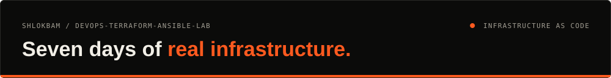
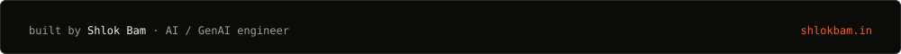

<div align="center">




<a href="#what-it-does">What it does</a> · <a href="#stack">Stack</a> · <a href="#run-it">Run it</a> · <a href="https://journal-murex-three.vercel.app/journal/my-7-day-devops-lab-terraform-ansible-hashicorp-vault">Write-up</a>

</div>

A day-by-day lab that goes from one EC2 instance to a custom VPC, remote state, multi-environment workspaces and Vault-managed secrets, plus an Ansible playbook. Written up on my journal: [My 7-Day DevOps Lab](https://journal-murex-three.vercel.app/journal/my-7-day-devops-lab-terraform-ansible-hashicorp-vault).

## What it does

| Folder | What I built |
| :--- | :--- |
| [`Terraform/main.tf`](Terraform/main.tf) | Day 1–2: a `t2.micro` Ubuntu EC2 instance |
| [`Terraform/day_3/`](Terraform/day_3) | A reusable EC2 module with inputs and outputs |
| [`Terraform/day_4/`](Terraform/day_4) | Remote state in an S3 backend |
| [`Terraform/day_5/`](Terraform/day_5) | A custom VPC, subnet, internet gateway, routes and security group, then SSH provisioners that deploy a Flask app |
| [`Terraform/day_6/`](Terraform/day_6) | Workspaces that pick the instance size per environment: dev `t2.micro`, stage `t2.medium`, prod `t2.xlarge` |
| [`Terraform/day_7/`](Terraform/day_7) | HashiCorp Vault with AppRole auth, reading a KV secret at plan time |
| [`Ansible/error_handling/`](Ansible/error_handling) | A playbook that upgrades OpenSSH/OpenSSL and installs Docker only when it's missing |

Screenshots of the plans, the AWS console and the running app are in [`Devops project ss/`](Devops%20project%20ss).

## Stack

| Area | Tools |
| :--- | :--- |
| Provisioning | Terraform ≥ 1.5, AWS (EC2, VPC, S3) |
| Configuration | Ansible ≥ 2.15 |
| Secrets | HashiCorp Vault (AppRole, KV) |
| App | Python, Flask |

## Run it

Needs the AWS CLI with credentials, Terraform and Ansible. Bucket names, key pairs and Vault IDs are placeholders: set your own before applying.

```bash
cd Terraform/day_5
terraform init && terraform plan
terraform apply -auto-approve

ansible-playbook -i Ansible/error_handling/inventory.ini Ansible/error_handling/main.yaml
```

---

<div align="center">

<a href="https://shlokbam.in"></a>

<a href="https://shlokbam.in">shlokbam.in</a> · <a href="https://www.linkedin.com/in/shlokbam/">LinkedIn</a> · <a href="https://github.com/shlokbam">More projects</a>

</div>
